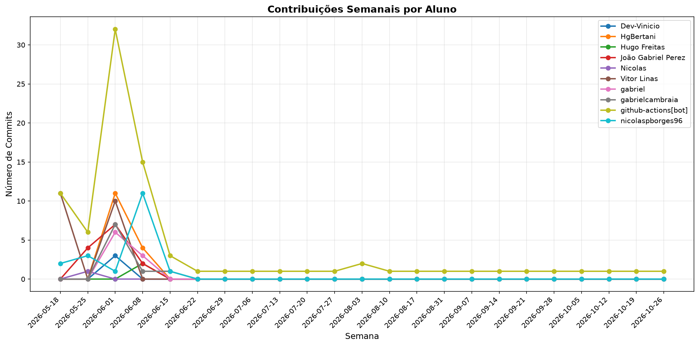

# 📊 Relatório de Contribuições do Projeto

**Última atualização:** 02/11/2026 00:30

---

## 📈 Resumo Geral de Contribuições

| Aluno                 |   Commits |   Linhas+ |   Linhas- |   Arquivos |   Docs Commits |   Docs Arquivos |
|-----------------------|-----------|-----------|-----------|------------|----------------|-----------------|
| Carlos Morais         |         2 |         7 |        15 |          2 |              2 |               2 |
| Dev-Vinicio           |        27 |     69475 |     52693 |        318 |             20 |              15 |
| HgBertani             |        15 |      1704 |       572 |         45 |              6 |               4 |
| Hugo Freitas          |        30 |       559 |        91 |         15 |             18 |               7 |
| João Gabriel Perez    |        37 |     10244 |      2603 |        114 |             10 |               4 |
| Nicolas               |         6 |      7686 |      1021 |        106 |              2 |               2 |
| Vitor Linas           |        47 |      2220 |       711 |         23 |             20 |               4 |
| gabriel               |        22 |     10110 |      2055 |        106 |              3 |               1 |
| gabrielcambraia       |        27 |       960 |        59 |          5 |             14 |               4 |
| github-actions[bot]   |       197 |      1571 |      1531 |          3 |            192 |               1 |
| github-classroom[bot] |         1 |      2152 |         0 |         45 |              1 |              13 |
| nicolaspborges96      |        78 |     47103 |     18538 |        343 |             30 |               8 |

## 📅 Contribuições Semanais (Todo o Semestre)

**2026-10-26**: github-actions[bot]: 1

**2026-10-19**: github-actions[bot]: 1

**2026-10-12**: github-actions[bot]: 1

**2026-10-05**: github-actions[bot]: 1

**2026-09-28**: github-actions[bot]: 1

**2026-09-21**: github-actions[bot]: 1

**2026-09-14**: github-actions[bot]: 1

**2026-09-07**: github-actions[bot]: 1

**2026-08-31**: github-actions[bot]: 1

**2026-08-17**: github-actions[bot]: 1

**2026-08-10**: github-actions[bot]: 1

**2026-08-03**: github-actions[bot]: 2

**2026-07-27**: github-actions[bot]: 1

**2026-07-20**: github-actions[bot]: 1

**2026-07-13**: github-actions[bot]: 1

**2026-07-06**: github-actions[bot]: 1

**2026-06-29**: github-actions[bot]: 1

**2026-06-22**: github-actions[bot]: 1

**2026-06-15**: gabrielcambraia: 1, github-actions[bot]: 3, nicolaspborges96: 1

**2026-06-08**: HgBertani: 4, Hugo Freitas: 2, João Gabriel Perez: 2, gabriel: 3, gabrielcambraia: 1, github-actions[bot]: 15, nicolaspborges96: 11

**2026-06-01**: Dev-Vinicio: 3, HgBertani: 11, João Gabriel Perez: 7, Vitor Linas: 10, gabriel: 6, gabrielcambraia: 7, github-actions[bot]: 32, nicolaspborges96: 1

**2026-05-25**: João Gabriel Perez: 4, Nicolas: 1, github-actions[bot]: 6, nicolaspborges96: 3

**2026-05-18**: Vitor Linas: 11, github-actions[bot]: 11, nicolaspborges96: 2

## 📊 Visualização Gráfica

## ℹ️ Observações

- **Commits**: Número total de commits realizados

- **Linhas+**: Linhas de código adicionadas

- **Linhas-**: Linhas de código removidas

- **Arquivos**: Número de arquivos únicos modificados

- **Docs Commits**: Commits em arquivos de documentação

- **Docs Arquivos**: Arquivos de documentação modificados

---

*Relatório gerado automaticamente via GitHub Actions*
